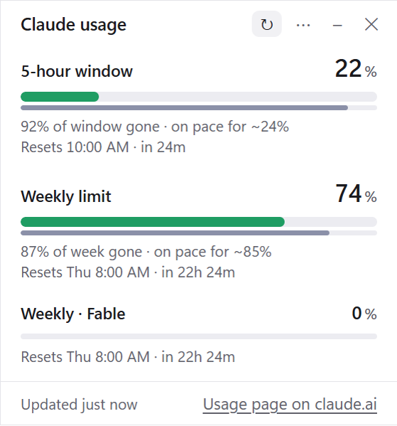

# Claude Usage Meter

Keep an eye on your Claude plan limits without opening the usage page.

Claude plans have a **5-hour usage window** and a **weekly limit**. This project shows how much of each you've used, and when each one resets, in two ways:

- **Desktop widget (Windows):** a small always-on-top window that sits in a corner of your screen, like a sticky note.
- **Claude Code plugin:** a status line under the Claude Code prompt.

Use either one, or both.

<p align="center"></p>

> **Unofficial.** This is a personal project. It is not made, endorsed, or supported by Anthropic. It relies on an undocumented endpoint that could change at any time (see [How it works](#how-it-works)).

---

## Desktop widget (Windows)

### Features

- Works with **Claude Code** or just a **claude.ai account**. If you don't use Claude Code, sign in to claude.ai right inside the app.
- Shows your **5-hour window** and **weekly limit** as bars, with the exact percentage and reset time ("Resets 4:18 PM · in 2h 14m"). Any model-specific weekly limits appear too.
- **Pace check:** a thinner bar under each one shows how much of the window has passed, so you can see whether you're using it faster than time is passing. A line underneath says where you're heading, like "66% of week gone · on pace for ~49%". If you'd run out before the reset, it warns you in amber, like "out by Tue 12:14 AM". The projection appears once 10% of a window has passed, since earlier guesses jump around. Turn it off with **⋯ → Show time elapsed**.
- Colors change as you get closer: **green** below 75%, **amber** from 75%, **red** from 90%.
- **Stays on top** of other windows. Drag it anywhere, and drag its left or right edge to make it wider or narrower. It opens in the same spot and size next time, and its height always fits what's shown.
- The **taskbar button shows the numbers** too (e.g. "Claude 42% · 18%"), even when it's minimized.
- **Windows notifications** when either limit crosses 75% and 90%, once per window. There's no pop-up when you're already looking at the widget, for example right after you click refresh.
- Refreshes every 5 minutes. You can change that to 2, 10, or 15.
- Optionally starts with Windows. It follows your light or dark theme.

### Install

1. Download `Claude-Usage-Meter-Setup-<version>.exe` from the [latest release](https://github.com/brianwaletzko/claude-usage-meter/releases/latest).
2. Run it. It installs for your user only, with no admin rights needed, and adds a desktop shortcut and a Start menu entry.
3. The app isn't code-signed, so Windows SmartScreen may show "Windows protected your PC". Click **More info → Run anyway**.

Prefer not to install anything? Download `Claude-Usage-Meter-Portable-<version>.exe` instead and run it directly.

To update, close the widget (**✕**) and run the newer installer. It replaces the old version and keeps your settings and sign-in.

To uninstall, go to **Settings → Apps → Installed apps → Claude Usage Meter**.

### Requirements

- Windows 10 or 11 (64-bit)
- A paid Claude plan with usage limits, such as Pro or Max
- One of these two ways to sign in:
  - **claude.ai (no extra software needed).** On first launch, click **Sign in to claude.ai** and sign in in the window that opens. The app remembers it.
  - **Claude Code.** If Claude Code is installed and signed in, the widget reuses that sign-in automatically, so there's nothing to enter.

If both are available, the widget uses Claude Code first. To choose, use **⋯ → Read usage with**.

### Using it

| To… | Do this |
| --- | --- |
| Move it | Drag the title bar |
| Make it wider or narrower | Drag its left or right edge |
| Refresh now | Click **↻** |
| Change settings | Right-click anywhere, or click **⋯** |
| Hide it for a while | Click **–** (minimize) |
| Close it | Click **✕**, then reopen from the desktop or Start menu |

The menu has:

- **Display:** Always on top, Move to bottom-right corner, Show time elapsed
- **Checking:** Refresh now, Check every (2, 5, 10, or 15 minutes), Alert at 75% and 90%, Start with Windows
- **Sign-in:** Read usage with (Claude Code or claude.ai), Sign in to / Sign out of claude.ai, Renew sign-in, Auto-renew when expired
- **Other:** Open Claude usage page, Open log file, Quit

### Troubleshooting

**"No sign-in found"**
Click **Sign in to claude.ai** and sign in. Or, if you use Claude Code, run `claude` in a terminal and sign in. The widget looks for `%USERPROFILE%\.claude\.credentials.json`, which the command-line `claude` creates. The Claude desktop app and some editor extensions don't create it.

**Google sign-in doesn't work in the sign-in window**
Google sometimes refuses to sign in inside apps. Use **Continue with email** instead. claude.ai emails you a code or link to finish signing in.

**"Not signed in to claude.ai in this app"**
Your claude.ai sign-in ended (for example, you signed out everywhere). Click **Sign in to claude.ai** again.

**"claude.ai's security check blocked the usage request"**
claude.ai occasionally asks browsers to prove they're human. Sign in again from the menu, or wait a few minutes.

**"Your Claude Code sign-in has expired"**
Claude Code refreshes its sign-in whenever you use it. If you mostly use claude.ai instead, the saved sign-in can expire. If you're also signed in to claude.ai in the app, the widget switches to that automatically. Otherwise click **Renew sign-in**. That runs a one-word Claude Code prompt on the smallest model, which refreshes the sign-in and uses a tiny amount of your plan. To do this automatically, turn on **Auto-renew when expired** in the menu. It runs at most once every 10 minutes.

**"Signed in with an API key"**
Claude Code is using an Anthropic API key, not a Claude subscription. API keys don't have plan limits, so there's nothing to show.

**It shows an error after it was working**
Anthropic may have changed the usage endpoint. Check for a newer release, or [open an issue](https://github.com/brianwaletzko/claude-usage-meter/issues).

**Reporting a problem**
Click **⋯ → Open log file**. The log lists each check, error and alert with the time. It never contains your sign-in. Include the relevant lines when you [open an issue](https://github.com/brianwaletzko/claude-usage-meter/issues).

---

## Claude Code plugin

Shows your usage in Claude Code's status line:

```
Usage · 5h: 42% (resets Sun 3:15 PM) · Week: 18% (resets Thu 9:00 AM)
```

It also shows a notification when either limit crosses 50%, 75%, and 90%. The figures are account-wide, so usage on claude.ai and in other sessions counts too. The line updates whenever Claude replies. Reset times are currently shown in US Central time.

To install, run this in a Claude Code session:

```
/plugin install usage-meter --marketplace brianwaletzko/claude-usage-meter
```

Answer `y` to add the marketplace, then choose the **user** scope so it loads in every session.

---

## How it works

Both tools read the same usage numbers that claude.ai's **Settings → Usage** page shows. Checking them doesn't count against your plan.

The desktop widget:

- **With Claude Code:** it reads the sign-in token that Claude Code saves on your computer. It **never changes, refreshes, or copies** that file, so it can't sign you out of Claude Code. It sends that token **only to `api.anthropic.com`**.
- **With claude.ai:** you sign in on claude.ai's real sign-in page, inside the app, and the app never sees your password. The sign-in is kept in the app's own private browser profile, separate from your normal browser, and is sent **only to `claude.ai`**. **Sign out of claude.ai** in the menu deletes it.
- It doesn't talk to any other server, and it has no analytics or tracking.
- Stores its settings (window position and size, refresh interval, alert history) in `%APPDATA%\Claude Usage Meter\config.json`, and a troubleshooting log in `meter.log` in the same folder.

The usage endpoints (`api.anthropic.com/api/oauth/usage` and claude.ai's `/api/organizations/…/usage`) are **undocumented**. Other community usage meters use them too, but Anthropic hasn't published them and could change or remove them without notice.

---

## Build from source

The desktop app is in [`desktop/`](desktop/). It's built with Electron, and you need a current LTS version of Node.js.

```powershell
cd desktop
npm install
npm test           # unit tests
npm start          # run it
npm run dist:win   # build the installer and portable .exe into desktop\dist\
```

New versions are built automatically. Pushing a version tag (e.g. `v0.6.0`, matching `desktop/package.json`) runs the [Release desktop app](.github/workflows/release-desktop.yml) workflow. It tests, builds, and attaches both `.exe` files to the GitHub Release.

The plugin is at the repository root ([`hooks/`](hooks/), [`.claude-plugin/`](.claude-plugin/)). To check it, run:

```
claude plugin validate .
claude plugin test .
```

## Contributing

Bug reports and suggestions are welcome in [Issues](https://github.com/brianwaletzko/claude-usage-meter/issues). If the widget stops working, please include the message it shows.

## License

[MIT](LICENSE) © 2026 Brian Waletzko
